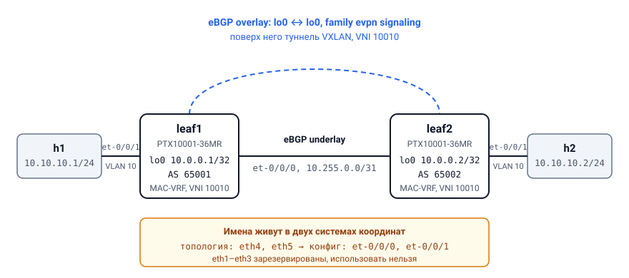
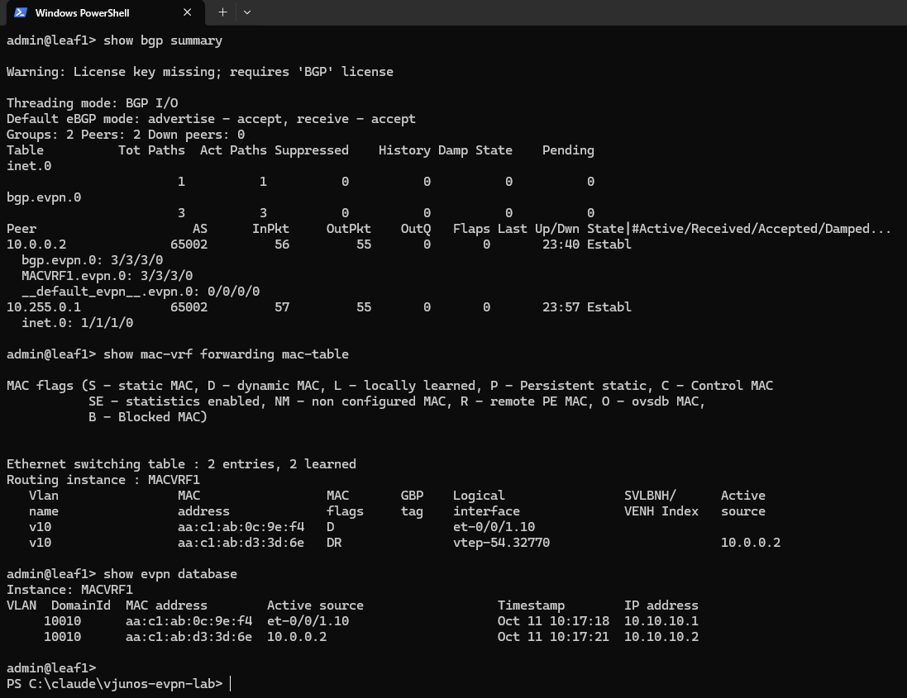
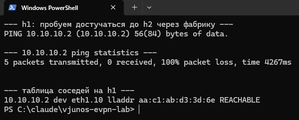
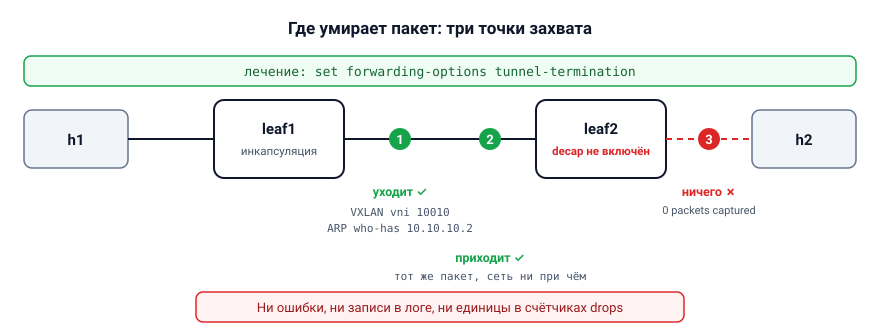
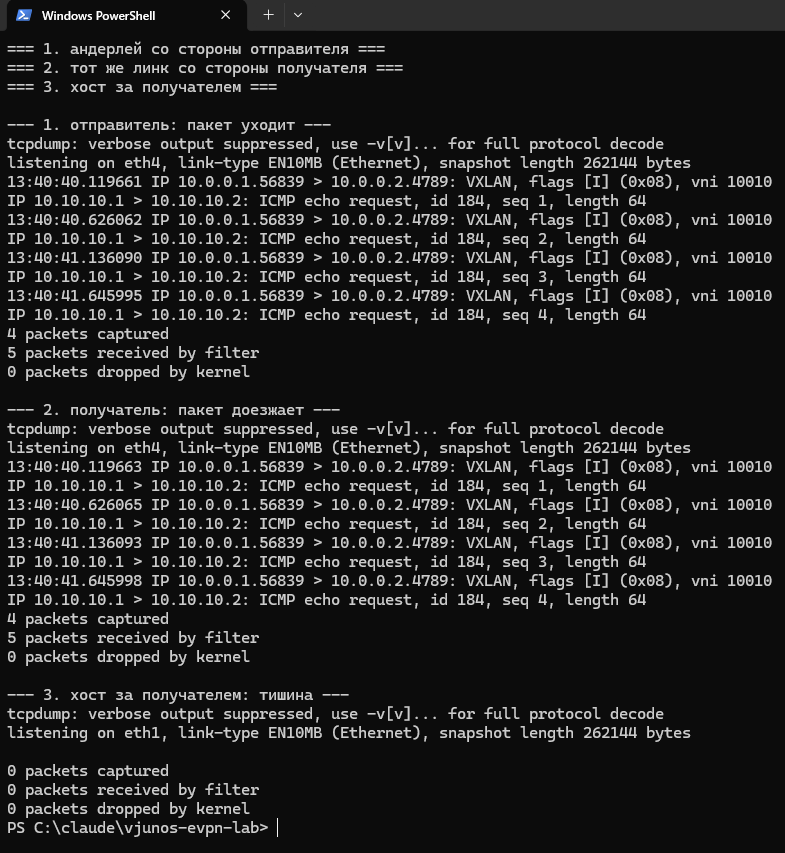
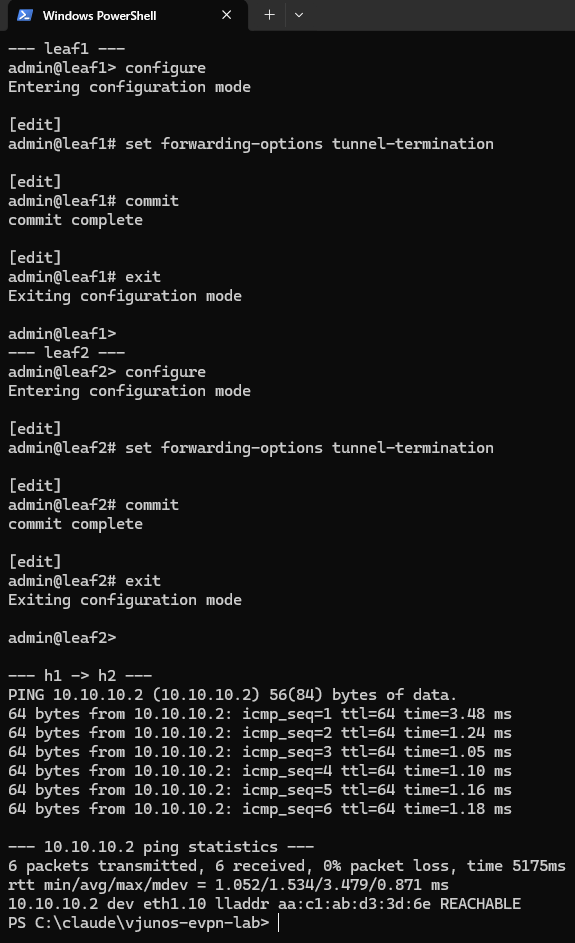

# Фабрика EVPN-VXLAN, которая выглядит исправной и не передаёт ни одного пакета

Почти все статьи про EVPN-VXLAN заканчиваются одинаково: автор показывает
вывод `show evpn database`, в нём видны MAC-адреса соседнего листа, и дальше
идёт фраза вроде «фабрика работает». Я собрал такую фабрику на свободных
образах Junos, получил ровно этот вывод — и не смог передать между хостами
ни одного пакета.

Разбор занял вечер и оказался полезнее, чем сама сборка. Ниже — как поднять
фабрику дома на обычном десктопе под Windows, почему `show evpn database`
ничего не доказывает, и как мерить отказы так, чтобы числам можно было
верить. Всё воспроизводится: конфиги и скрипты в репозитории, ссылка в конце.

## Что понадобится и чего не понадобится

Juniper раздаёт виртуальные образы Junos бесплатно — без лицензии и без
ограничения по времени, условие одно: непродакшен и низкий трафик. Образов
несколько, и выбрать правильный оказалось первым нетривиальным шагом.

Очевидный кандидат — **vJunos-switch**, виртуальный EX. Он не подошёл, и
причина не в ресурсах. В требованиях прямым текстом:

> vJunos-switch is not supported on EVE-NG or any other deployments that
> launch vJunos from within a VM due to the constraints of deeply nested
> virtualization.

Архитектура у него унаследована от vMX: внутри виртуалки уже вложены VCP и
VFP. Третьего слоя вложенности он не тянет. А у меня хост — Windows, то есть
containerlab живёт в WSL2, а WSL2 — это виртуальная машина. Мимо. Там же, в
требованиях, указан только Intel VT-x, а у меня Ryzen.

Подошёл **cJunosEvolved** — контейнерный Junos OS Evolved, эмулирующий
транспортные PTX: `PTX10001-36MR` на чипсете Express 4 (флавор BT) или
`PTX10002-36QDD` на Express 5 (BX). В его требованиях написано ровно то,
чего не хватало:

> any x86 processor (Intel or AMD) with VT-x capability

и отдельно — что containerlab является поддерживаемым способом развёртывания.
Цена вопроса: 8 ГБ памяти и 4 ядра на узел против 5 ГБ у vJunos-switch,
плюс 20 ГБ диска на контейнер в рантайме с ростом до 40.

Отдельная мелочь, которая экономит полчаса: **через поиск по сайту эти
продукты не находятся**. Juniper сам об этом предупреждает и даёт прямые
ссылки. Для cJunosEvolved это `support.juniper.net/support/downloads/?p=cjunos-evolved`.
Файл `cJunosEvolved-26.2R1.7-EVO.tar.gz` весит 1822 МБ и после `docker load`
разворачивается в образ на 4.55 ГБ.

Железо у меня такое: Ryzen 5 5600X (6 ядер / 12 потоков), 32 ГБ, Windows 11.

## Хост под Windows: что проверить до начала

cJunosEvolved — это KVM-виртуалка внутри контейнера, значит внутри WSL2
обязан быть `/dev/kvm`. Проверяется до всего остального:

```bash
ls -l /dev/kvm
kvm-ok
# INFO: /dev/kvm exists
# KVM acceleration can be used
```

У меня он оказался на месте, и флаг `svm` прокинут в гостя — то есть
вложенная виртуализация на AMD в WSL2 работает. Этого факта я не нашёл ни в
одной инструкции: все они написаны под bare-metal Linux на Intel.

Дистрибутив я поставил отдельный и сразу на другой диск, чтобы не забивать
системный:

```bash
wsl --install -d Ubuntu-24.04 --no-launch --location F:\WSL\clab --name clab
```

В `.wslconfig` подняты лимиты — по умолчанию WSL2 берёт половину памяти
хоста, на два узла по 8 ГБ этого не хватит:

```ini
[wsl2]
memory=26GB
processors=12
nestedVirtualization=true
vmIdleTimeout=-1
```

Про `vmIdleTimeout=-1` скажу отдельно, потому что без него я потерял первый
собранный стенд. **WSL гасит дистрибутив, когда в нём не остаётся ни одного
процесса**, и уносит с собой докер вместе со всеми контейнерами. Выглядит
это так: containerlab отчитался об успешном развёртывании, вы выходите из
шелла, возвращаетесь — а `docker ps` пуст, и ничего в логах. Лечится этой
строкой плюс любым живым процессом внутри.

Докер нужен **не ниже 28.0.0**, и это не придирка. В документации Juniper
отдельное предупреждение: на более старых версиях интерфейсы подключаются к
контейнеру не в том порядке, и трафик между узлами просто не идёт. Отказ,
разумеется, немой. Я ставил из официального репозитория, приехал 29.9.0.

## Сборка фабрики



Топология простейшая: два листа спина к спине, по хосту за каждым.
Андерлей — eBGP по прямому линку, оверлей — eBGP между loopback'ами с
`family evpn signaling`, поверх MAC-VRF с VNI 10010.

```yaml
name: evpn2
topology:
  kinds:
    juniper_cjunosevolved:
      image: cjunosevolved:26.2R1.7-EVO
  nodes:
    leaf1:
      kind: juniper_cjunosevolved
      startup-config: leaf1.conf
    leaf2:
      kind: juniper_cjunosevolved
      startup-config: leaf2.conf
    h1: { kind: linux, image: alpine:3.20 }
    h2: { kind: linux, image: alpine:3.20 }
  links:
    - endpoints: ["leaf1:eth4", "leaf2:eth4"]
    - endpoints: ["leaf1:eth5", "h1:eth1"]
    - endpoints: ["leaf2:eth5", "h2:eth1"]
```

Здесь первая ловушка для тех, кто привык к Junos. **В топологии имена
линуксовые, в конфиге — джуниперовские.** `eth0` — менеджмент, `eth1`–`eth3`
зарезервированы и трогать их нельзя, а `eth4` и дальше соответствуют
`et-0/0/0` и дальше. То есть линк описывается как `leaf1:eth4`, а
адрес на него вешается на `et-0/0/0`.

Конфигурация листа, сокращённо:

```
interfaces {
    et-0/0/0 { unit 0 { family inet { address 10.255.0.0/31; } } }
    et-0/0/1 {
        flexible-vlan-tagging;
        encapsulation extended-vlan-bridge;
        unit 10 { vlan-id 10; }
    }
    lo0 { unit 0 { family inet { address 10.0.0.1/32; } } }
}
routing-instances {
    MACVRF1 {
        instance-type mac-vrf;
        service-type vlan-based;
        protocols { evpn { encapsulation vxlan; } }
        vtep-source-interface lo0.0;
        route-distinguisher 10.0.0.1:10;
        vrf-target target:65000:10;
        vlans {
            v10 {
                vlan-id 10;
                interface et-0/0/1.10;
                vxlan { vni 10010; }
            }
        }
    }
}
```

Две мелочи, на которых я споткнулся при вводе конфигурации. Первая:
интерфейс привязывается **не к инстансу, а к VLAN внутри него**, иначе
получите `EVPN: Interface et-0/0/1.10 must be added in a bridge-domain/vlan`.
Вторая: как только трогаешь стансу `system`, `commit` требует
`root-authentication`, которого в образе нет. Предупреждение про
отсутствующую лицензию BGP можно игнорировать, Juniper об этом пишет прямо.

### Сколько это грузится

Отдельный пункт, потому что ожидания тут ломаются об реальность:

| Событие | Время |
|---|---|
| `containerlab deploy` вернул управление | 6 секунд |
| Загрузка ВМ внутри контейнера (из лога) | 220 секунд |
| CLI реально ответил | **814 секунд** |

containerlab через шесть секунд рисует красивую таблицу со статусом
`running` — и это правда, контейнер запущен. Но до момента, когда с
устройством можно разговаривать, проходит почти четырнадцать минут.
В документации containerlab написано «около 5 минут»; у меня втрое больше,
скорее всего из-за переподписки CPU. Любой скрипт, который после `deploy`
сразу лезет настраивать, развалится.

И ещё: `docker exec <node> cli -c "show version"` **не работает** — отдаёт
приглашение и молчит. Потому что внутри контейнера крутится виртуалка, а
`cli` в контейнере лишь обёртка над её консолью. Работает обычный SSH на
адрес, который выдал containerlab, с учёткой `admin` / `admin@123`.
Многострочные конфиги прекрасно заходят туда heredoc'ом.

## Фабрика собралась. Трафика нет


Теперь то, ради чего всё это писалось.



*Всё, что принято показывать как доказательство работоспособности фабрики.*


BGP поднялся с обеих сторон:

```
Peer                AS      InPkt   OutPkt  Last Up/Dwn  State
10.0.0.2         65002          7        6         1:28  Establ
  bgp.evpn.0: 1/1/1/0
10.255.0.1       65002          7        5         1:39  Establ
  inet.0: 1/1/1/0
```

Маршруты EVPN разошлись в обе стороны — и type-2 с MAC-адресами хостов, и
type-3 для BUM-трафика. В базе EVPN на втором листе честно лежит MAC
хоста из-за первого, с правильным IP:

```
Instance: MACVRF1
VLAN  DomainId  MAC address        Active source   IP address
     10010      aa:c1:ab:7e:89:07  10.0.0.1        10.10.10.1
```

MAC-таблица знает удалённый адрес и указывает на туннель:

```
   Vlan    MAC                 MAC flags   Logical interface    Active source
   v10     aa:c1:ab:27:09:e8   DR          vtep-54.32770        10.0.0.2
   v10     aa:c1:ab:7e:89:07   D           et-0/0/1.10
```

Туннельные эндпоинты на месте, VNI 10010 присутствует, loopback'и
пингуются за 2 миллисекунды. По всем признакам, которые обычно приводят в
статьях как доказательство, фабрика работает.

А `ping` между хостами даёт сто процентов потерь.

Причём таблица соседей на хосте при этом выглядит здоровой — MAC второго
хоста разрешён, запись в состоянии `REACHABLE`. То есть обманывает не только
вывод с коммутаторов: и на самом хосте всё в порядке, просто трафик не ходит.
(В другом прогоне того же стенда ARP не разрешался и запись висела в
`INCOMPLETE` — от чего зависит, я не выяснил, и выдавать догадку за объяснение
не буду.)




*И при этом между хостами не проходит ничего.*

### Разбор

Отказ немой: ни ошибки, ни записи в логе, ни единицы в счётчиках drops.
Поэтому единственный способ — идти по пути пакета с tcpdump и смотреть, где
он исчезает.




**Шаг первый, отправитель.** Слушаем андерлейный интерфейс со стороны
первого листа:

```
13:40:40.119661 IP 10.0.0.1.56839 > 10.0.0.2.4789: VXLAN, flags [I] (0x08), vni 10010
IP 10.10.10.1 > 10.10.10.2: ICMP echo request, id 184, seq 1, length 64
13:40:40.626062 IP 10.0.0.1.56839 > 10.0.0.2.4789: VXLAN, flags [I] (0x08), vni 10010
IP 10.10.10.1 > 10.10.10.2: ICMP echo request, id 184, seq 2, length 64
4 packets captured
```

Инкапсуляция работает. Эхо-запрос завёрнут в VXLAN с правильным VNI и
отправлен правильному соседу.

**Шаг второй, получатель.** Тот же линк со стороны второго листа:

```
13:40:40.119663 IP 10.0.0.1.56839 > 10.0.0.2.4789: VXLAN, flags [I] (0x08), vni 10010
IP 10.10.10.1 > 10.10.10.2: ICMP echo request, id 184, seq 1, length 64
4 packets captured
```

Те же пакеты, с точностью до микросекунд. Сеть между узлами ни при чём.

**Шаг третий, хост за получателем.** Ноль.

```
listening on eth1, link-type EN10MB (Ethernet), snapshot length 262144 bytes
0 packets captured
0 packets received by filter
0 packets dropped by kernel
```



То есть пакет приходит на оконечную точку туннеля и умирает в ней.
Симметрично в обе стороны. Конфигурация при этом валидная, контрол-плейн
идеальный, счётчики чистые.

Разгадка нашлась в списке ограничений cJunosEvolved — одной фразой среди
прочих:

> For cJunosEvolved to function correctly as a VXLAN Tunnel End Point (VTEP),
> you must configure tunnel termination using the `set forwarding-options
> tunnel termination` command. Otherwise, the traffic in the tunnel drops on
> the egress VTEP.


Лечение — одна строка на каждый узел, применяется на живую:

```
set forwarding-options tunnel-termination
```

Сразу после `commit` пинг идёт: 0% потерь, 1.1 мс.



Да, это особенность конкретного виртуального образа, а не Junos вообще. Но
поучительна здесь не сама строка, а форма отказа. **Весь контрол-плейн
рапортовал успех.** Все команды, которые принято приводить как
доказательство работоспособности фабрики, показывали именно то, что должны
показывать. Если бы я верил выводу `show evpn database`, я бы ещё долго
искал проблему в BGP и в политиках импорта.

## Как мерить отказы

Теперь, когда фабрика передаёт трафик, можно заняться тем, ради чего
виртуальные лабы вообще поднимают, — ломать её и смотреть на часы.

Первый вопрос — чем мерить. Ответ «пингом» не годится: `ping` шлёт пакет
раз в секунду, то есть провал короче секунды он не увидит в принципе, а
более длинный округлит до целых секунд. Для сетевых отказов это всё равно
что мерить спринт настенным календарём.

Я написал простую мерилку: UDP-поток с порядковым номером в каждом пакете,
на приёмнике считается разрыв в последовательности и, главное, разрыв во
времени между соседними пришедшими пакетами. При 1000 pps это даёт
разрешение около миллисекунды.

Тут надо сразу оговорить потолок. В ограничениях cJunosEvolved написано:
максимум **2000 pps** и 3–5 Мбит/с суммарно по всем интерфейсам. Значит
1000 pps — это половина паспортной способности симулятора, выше лезть
бессмысленно: будешь мерить эмулятор, а не сеть.

И мерилку тоже пришлось чинить дважды, о чём честно скажу, потому что
обе ошибки типовые.

**Первая: отправитель врал о своей скорости.** Наивная пауза между пакетами
через `time.sleep()` при интервале в миллисекунду даёт не 1000 пакетов в
секунду, а около 740 — накладные расходы самого системного вызова
съедают заметную часть бюджета. Лечится так: спим, только пока до
следующей отправки есть запас, а последние полторы миллисекунды
дожидаемся в цикле. И обязательно печатаем достигнутую скорость:
инструмент, который врёт о собственной скорости, хуже отсутствия
инструмента.

**Вторая: приёмник умирал во время измеряемого простоя.** Он завершался
по таймауту тишины — и честно завершался ровно тогда, когда начинался
отказ, который и надо было измерить. Правильно — работать фиксированное
окно по часам, заведомо длиннее планируемого простоя.

## Первые числа

**Базовая линия.** Фабрика в покое, 1000 pps, 10 секунд:

```
sent 10001 packets in 10.00s = 1000 pps (requested 1000)
received 10001, lost 0, loss 0.0%
```

Потерь нет. Худший разрыв между соседними пакетами, если отбросить
артефакт на самом конце потока, — около 7 миллисекунд. Это и есть
разрешающая способность стенда: провал короче десятка миллисекунд
достоверно не различается.

**Отказ линка, попытка первая.** Гасим андерлейный интерфейс штатно, через
`deactivate` и `commit`:

```
простой 26132.9 мс, потеряно 25911 пакетов
```

Число мусорное, и вот почему. Команда на выключение ушла на 8-й секунде
потока. Трафик встал на 10.7-й. `commit` вернул управление на 15.2-й.
**`commit` на этой платформе занимает около семи секунд** — и что из этого
считать моментом отказа, непонятно.

Отсюда методический вывод, который я считаю главным в этой части:
**инструмент управления нельзя использовать как источник времени события**.
Если замер привязан к `commit`, вы измеряете латентность `commit`, а не
сходимость сети.

**Отказ линка, попытка вторая.** Гасим линк мгновенно, со стороны Linux,
не трогая Junos вообще:

```
линк погашен на 10.171 с, поднят на 20.324 с
последний пакет до разрыва  seq 10004  = 10.004 с
первый пакет после разрыва  seq 20158  = 20.158 с
простой 10109 мс, потеряно 10153 пакета
```

Простой **совпал** с тем временем, на которое линк был погашен: 10.11
секунды против 10.15 административного простоя. То есть трафик возобновился
сразу, как только линк вернулся, — в пределах погрешности стенда.

## Что из этого следует

Результат выглядит скучно ровно до того момента, пока не задашь вопрос:
а почему восстановление мгновенное?

Потому что **восстанавливать было нечего**. За десять секунд отсутствия
линка контрол-плейн не заметил ничего. Дефолтный hold-time BGP — девяносто
секунд, сессия спокойно пережила обрыв, маршруты никто не отзывал, VTEP
никто не перепрограммировал. Линк вернулся — пакеты пошли.

А теперь обратная сторона той же медали, и это то, ради чего стоит
поднимать такие стенды. Будь отказ **не временным**, чёрная дыра длилась бы
не десять секунд, а до истечения hold-time. И всё это время `show bgp
summary` показывал бы честный `Establ`, а трафик уходил бы в никуда.

Девяносто секунд по умолчанию — это не «настройка по умолчанию». Это мина,
и обезвреживают её не тюнингом таймеров ради тюнинга, а пониманием, какой
именно вид отказа вы собираетесь переживать: пропадание линка, падение
соседа или тихую смерть форвардинга при живой сессии. Это три разные
истории с разным временем реакции, и дефолт закрывает из них ровно одну.

## Честные границы этого стенда

Виртуальный образ — не железо, и выдавать его миллисекунды за
характеристики PTX было бы враньём. В ограничениях cJunosEvolved прямо
сказано, что не поддерживаются «QoS и протоколы с агрессивными
(sub-second) таймерами, включая BFD». Для BT-флавора туда же — MC-LAG,
VRRP и IPv6 в андерлее и оверлее.

Поэтому всё, что здесь измерено, — это **механика и порядок величин**:
что отказ бывает разных видов, что разница между ними принципиальная, и
откуда берётся девяностосекундная дыра. Абсолютные числа на вашем железе
будут другими. Но вопрос, который стоит задать своей сети, от этого не
меняется.

## Что дальше

Главный замер — отказ не линка, а узла — на топологии из двух листьев
сделать нельзя: убивая второй лист, убиваешь и получателя. Нужен резервный
путь: либо второй линк и ECMP в андерлее, либо хост, подключённый к обоим
листьям через ESI-LAG. Это следующая часть, и там же — сравнение видов
отказа в одной таблице.

Репозиторий с топологиями, конфигами, скриптами сборки и мерилкой:
**ссылка будет здесь**.

Если соберётесь повторять — закладывайте по 8 ГБ памяти на узел, около
получаса на первую загрузку и то самое `tunnel-termination` сразу, чтобы
не повторять мой вечер.
